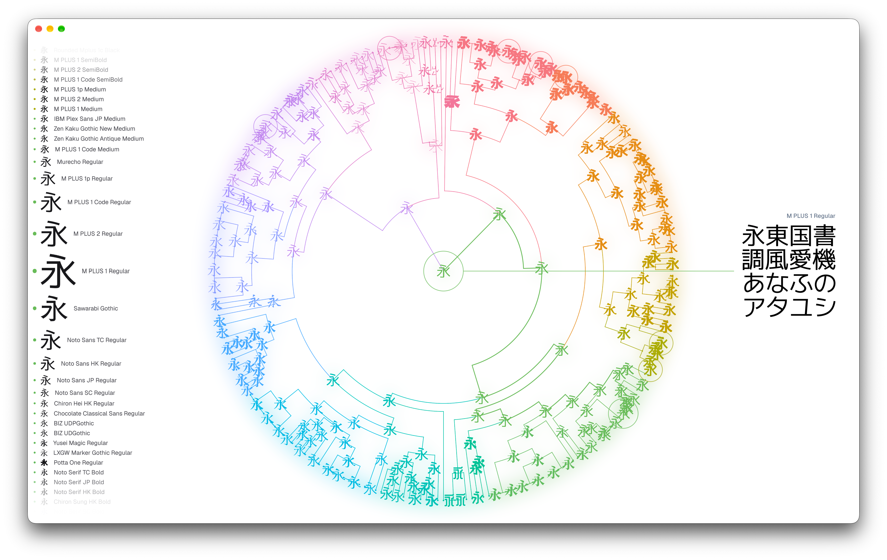
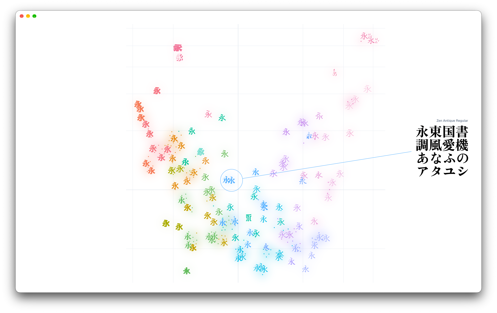

# FontCluster

Explore fonts by visual similarity. FontCluster uses FontCLIP to group fonts and
lets you browse them through interactive trees, scatter plots, and text
previews.

### [Download the latest release](https://github.com/MugiSus/fontcluster-releases/releases/latest)

## Getting started

1. Install and open FontCluster. The bundled sample lets you explore the graph
   before running your own analysis.
2. Open the control panel, enter your sample text, and choose local fonts or a
   Google Fonts collection.
3. Under **Analyze**, use **Download Model** to install FontCLIP before your
   first analysis. The button shows the download size and disappears once the
   model is installed.
4. Choose **Generate New**, then explore the results in the graph and font list.
   Select a font to inspect its preview or copy its family name.

Models are downloaded from
[fontcluster-models](https://github.com/MugiSus/fontcluster-models) and cached
locally. If the selected model is missing, analysis stops with an error; it does
not download the model automatically.

## Acknowledgements

FontCluster's font-similarity engine is built on **FontCLIP**, and this app
would not exist without the research behind it. Deep thanks to its authors:

> Yuki Tatsukawa, I-Chao Shen, Anran Qi, Yuki Koyama, Takeo Igarashi, and Ariel
> Shamir. _FontCLIP: A Semantic Typography Visual-Language Model for
> Multilingual Font Applications._ Computer Graphics Forum 43 (Eurographics
> 2024). [arXiv:2403.06453](https://arxiv.org/abs/2403.06453) ·
> [DOI](https://doi.org/10.1111/cgf.15043) ·
> [Code](https://github.com/yukistavailable/FontCLIP)

Model provenance, attribution, and licensing information are documented in
[fontcluster-models](https://github.com/MugiSus/fontcluster-models). FontCluster
is also built with [Tauri](https://tauri.app/),
[Solid](https://www.solidjs.com/), and [Three.js](https://threejs.org/).

## License

Copyright © 2026 mugisus

Licensed under the GNU General Public License v2.0 or later (GPL-2.0-or-later).
See [LICENSE](LICENSE) for details.
